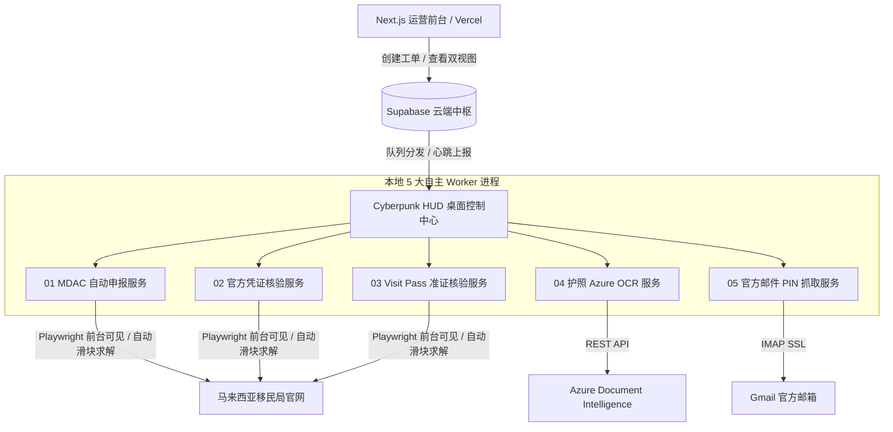

# 《MDAC 自动化生产系统日常运维与故障自愈手册 (Operations Runbook)》

> **版本**：v1.0 (生产固化版)  
> **适用环境**：Windows 桌面办公端 + Supabase 云端中枢 + Next.js 生产 Web  
> **服务组件**：Cyberpunk HUD 控制中心 + 5 大自主 Python Worker

---

## 一、系统架构与职责分工

---

## 二、5 大本地 Worker 职责与特性

| 编号 | Worker 标识 | 业务职责 | 运行特性 | 心跳周期 |
| :---: | :--- | :--- | :--- | :---: |
| **01** | `office-worker-desktop` | MDAC 入境卡自动申报填写与提交 | Playwright 浏览器右侧分屏可见；国籍变动后**强制重设 +86 区号**防呆覆盖 | 待命 60s / 繁忙 20s |
| **02** | `office-reg-check-desktop` | 官方登记凭证查询与 PDF 证据下载 | 自动识别并突破官网滑块；下载官方登记确认凭证写回 Storage | 待命 60s / 繁忙 20s |
| **03** | `office-visit-pass-desktop` | Visit Pass 电子入境准证核验 | 输入邮箱、区号、手机及 PIN；提取官方准证并清理历史旧截图 | 待命 60s / 繁忙 20s |
| **04** | `azure-ocr-worker` | 护照图片高精度结构化识别 | 自动提取姓名、护照号、国籍、生日、到期日与性别；置信度审计 | 待命 60s / 繁忙 20s |
| **05** | `office-gmail-pin` | 官方回执邮件 PIN 码自动抓取 | 复杂 HTML 表格 PIN 提取；时钟差自适应宽容匹配；成功即写回 | 待命 60s / 繁忙 20s |

---

## 三、日常运维管理指令集（一键脚本）

所有运维管理脚本均位于 `tools\` 目录下：

### 1. 启停与重启
- **一键启动**：`tools\start_workers.bat`
  - 自动检测是否已有实例运行；若已在运行则静默退出（**防重复启动**）；
  - 启动前自动执行一次日志轮转清理；
  - 静默后台拉起 Cyberpunk HUD 监控界面及 5 个 Worker。
- **一键停止**：`tools\stop_workers.bat`
  - 安全、平滑关闭 GUI 界面及 5 个 Python 子进程（释放浏览器与端口资源）。
- **一键重启**：`tools\restart_workers.bat`
  - 自动调用停止、等待 2 秒并重新拉起所有服务。

### 2. 高可用守护与防掉线配置（已生效）
- **开机自启动**：
  - 脚本：`C:\Users\Administrator\AppData\Roaming\Microsoft\Windows\Start Menu\Programs\Startup\Start-MDAC-Workers.vbs`
  - 效果：Windows 系统开机或用户登录时，**0 黑框弹窗、完全静默自动启动服务**。
- **15 分钟看门狗自愈（Windows Task Scheduler）**：
  - 任务名：`MDAC-Worker-Watchdog`
  - 逻辑：每隔 15 分钟自动检测 `worker_gui.py` 是否存活；若被误关或异常崩溃，看门狗将在 1 秒内自动拉起自愈。
- **日志自动滚动防爆盘**：
  - 脚本：`tools\maintenance_logs.ps1`
  - 规则：当日志文件超过 **15 MB** 时，自动保留最新 10,000 行历史并将旧文件轮转清理，自动删除超过 14 天的临时备份文件。

---

## 四、5 大典型故障现象与 1 分钟自愈方案

### 故障 1：某 Worker 在 GUI 上显示红色“服务离线”或黄色“正在接入”
- **根因**：网络短时间抖动或 Supabase 连接超时。
- **自愈机制**：Worker 内部内置了指数级退避重试（2s → 5s → 10s → 20s → 30s）。通常在网络恢复后 30 秒内会自动重连变绿。
- **人工干预**：双击运行桌面的 `tools\restart_workers.bat`，即可一键重置并恢复所有 Worker。

### 故障 2：官网滑块验证频繁重试
- **根因**：马来西亚官网服务器响应变慢或滑块背景图加载延迟。
- **自愈机制**：内置的 `slider_solver.py` 支持最多 3 次自适应识别重试。
- **人工干预**：如果连续失败，Worker 会将该工单置为 `NEEDS_REVIEW`，绝不阻塞整个队列，其他客户继续正常处理。

### 故障 3：台湾籍或外籍客户申报被拒
- **根因**：官网前端脚本在选择国籍（如 TWN）后会自动重置区号为 886。
- **防呆保障**：v1.0.45 版已加入强制防呆，在选择国籍后，脚本会自动执行第二道覆盖指令将 `#region` 重新强制锁死为配置的联系区号（如 86）。

### 故障 4：Gmail PIN 抓取超时
- **根因**：移民局官网邮件发送延迟，或 Google 账号应用专用密码（App Password）被撤销。
- **自查流程**：
  1. 登录 Web 前端进入 `/settings`（系统设置）；
  2. 检查 Gmail 邮箱地址与 16 位 App Password 是否最新；
  3. 点击设置页中的“测试连接”，确认连通性；
  4. 确认无误后在批次详情页点击“重新发起”，Worker 即可在下次轮询中抓取。

### 故障 5：批次任务卡住或需要取消重发
- **自查流程**：
  1. 打开 Web 前端 `/batches` 列表；
  2. 找到卡住的批次，点击进入详情；
  3. 点击右上角 **Cancel Batch**（关闭/取消批次）；
  4. 确认取消后，点击重新发起即可生成新的干净批次工单，Worker 会在 10 秒内自动领单执行。

---

## 五、安全与凭据规范

1. **凭证隔离**：
   - 生产数据库 Service Role Key、GitHub Token 严禁提交至公共公开仓库；
   - 本地桌面端通过 `.env.local` 加载私密凭据。
2. **证据留存审计**：
   - 所有核验成功的凭证截图均保存在 Supabase Storage `passport-documents` 私有桶中；
   - 客户敏感证件仅供官方核验提取，日志中严格抹除护照号明文与 PIN 码信息。
